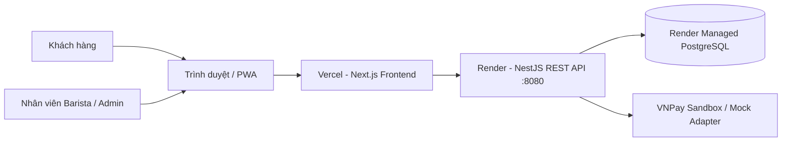
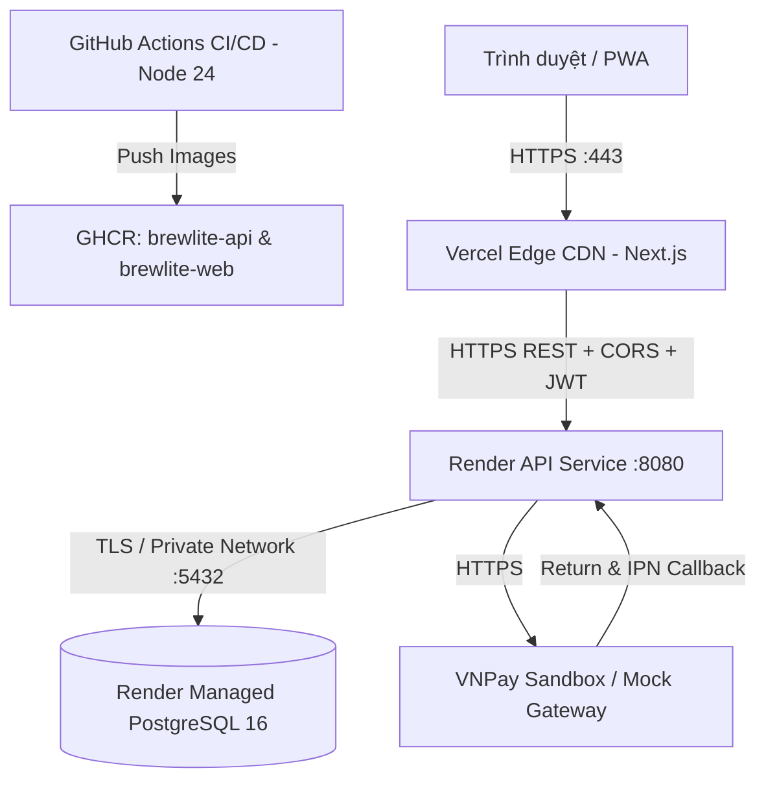

# BrewLite — Ứng dụng đặt cà phê không dùng tiền mặt

> **Đồ án môn học:** Công nghệ Phần mềm (Software Engineering) — Trường Đại học Sài Gòn (SGU)  
> **Phương pháp phát triển:** Agile Scrum  
> **Phiên bản:** Assignment 2: Requirements to Deployment (Khai thác Yêu cầu, Thiết kế Kiến trúc, CI/CD & Bàn giao)

---

## 1. Giới thiệu tổng quan

**BrewLite** là ứng dụng đặt cà phê trực tuyến không dùng tiền mặt (Cashless Coffee Ordering), giải quyết bài toán ùn tắc tại quầy thanh toán vào giờ cao điểm, tối ưu hóa quy trình pha chế của nhân viên Barista qua Staff Portal và nâng cao trải nghiệm đặt nước của khách hàng.

### Ngăn xếp công nghệ cốt lõi:
- **Frontend (Web):** Next.js 16 (App Router, React 19, TypeScript, TailwindCSS v4, Zustand) — Thiết kế Mobile-first, hỗ trợ PWA (`manifest.ts`).
- **Backend (API):** NestJS (TypeScript) — Kiến trúc Modular Monolith, RESTful API, Swagger (`/swagger`).
- **Cơ sở dữ liệu:** PostgreSQL 16+ kết hợp **Prisma ORM** (12 models, 9 enums) và cơ chế Migration tự động.
- **Đóng gói & Triển khai:** Docker & Docker Compose (Node 24 Alpine), GitHub Actions CI/CD, GitHub Container Registry (`ghcr.io`), Vercel (Web) & Render (API `:8080` & Managed PostgreSQL).

---

## 2. Cấu trúc Repository (Monorepo)

Dự án áp dụng mô hình **Monorepo** chuẩn hóa cấu trúc theo quy định tại Mục 9 của đề bài Assignment 2 và [ADR-001](docs/architecture/adr/001-monorepo.md):

```text
SWE_Project_Assignment2/
├── apps/
│   ├── api/                  # Dịch vụ Backend NestJS & Cấu hình Database
│   │   ├── prisma/           # Lược đồ schema.prisma, migrations & seed.ts
│   │   ├── src/              # Mã nguồn ứng dụng (Auth, Products, Orders, Payments, Promotions, Inventory, Health, Common)
│   │   ├── test/             # Kiểm thử E2E NestJS (app.e2e-spec.ts)
│   │   ├── Dockerfile        # Multi-stage Docker build (Node 24 Alpine)
│   │   ├── .env.example      # Biến môi trường mẫu Backend
│   │   └── package.json
│   └── web/                  # Ứng dụng Frontend Web / PWA Next.js
│       ├── app/              # 9 App Router routes (/, /products/[id], /cart, /orders, /orders/[id], /login, /register, /staff, /UserProfile)
│       ├── components/       # UI Components (Header, BottomNav, ProductCard, CartItem, CheckoutModal, StaffRoleGuard...)
│       ├── stores/           # Zustand State Management (cartStore.ts)
│       ├── tests/            # Frontend unit tests (vnpay-payment.test.mjs - 28 tests)
│       ├── public/           # Tài nguyên tĩnh (Hình ảnh, Icons)
│       ├── Dockerfile        # Multi-stage Docker build (Node 24 Alpine)
│       ├── .env.example      # Biến môi trường mẫu Frontend
│       └── package.json
├── docs/                     # Toàn bộ tài liệu kỹ thuật & Thiết kế hệ thống
│   ├── requirements/         # Task 1: Bối cảnh, Phạm vi & Đặc tả yêu cầu (SRS: 17 FRs & 20 NFRs)
│   │   ├── context-and-scope.md
│   │   └── SRS.md
│   ├── diagrams/             # Task 2: Các sơ đồ UML (PlantUML nguồn & ảnh SVG)
│   │   ├── activity-checkout.*   # Task 2.1: Activity Diagram
│   │   ├── sequence-checkout.*   # Task 2.2: Sequence Diagram (5 lifelines)
│   │   ├── class-domain.*        # Task 2.3: Domain Class Diagram (12 models, 9 enums) & Data Dictionary
│   │   ├── deployment.*          # Task 3.2: Deployment Diagram Production (Vercel, Render, GHCR, VNPay)
│   │   ├── usecase-overview.*    # Sơ đồ Use-case tổng quan toàn hệ thống
│   │   └── use-case-checkout.*   # Task 1.3: Đặc tả use-case trọng tâm
│   ├── architecture/         # Task 3.1: Kiến trúc hệ thống & Hồ sơ quyết định (ADR)
│   │   ├── README.md         # Chi tiết kiến trúc hệ thống
│   │   └── adr/              # ADR-001 (Monorepo), ADR-002 (Prisma), ADR-003 (State Machine)
│   ├── deployment.md         # Hướng dẫn chi tiết vận hành & triển khai Production
│   ├── Hướng dẫn đọc code và tích hợp.md # Bản đồ mã nguồn & hướng dẫn đọc hiểu cho nhóm
│   ├── Huong-dan-cau-hinh-VNPAY.md # Hướng dẫn cấu hình và chạy thử VNPay Sandbox
│   ├── Kiem-tra-migration-VNPAY.md # Đối chiếu và kiểm tra migration VNPay
│   └── traceability-matrix.md # Task 8.1: Ma trận truy vết bắt buộc (17 FRs & 20 NFRs)
├── tests/                    # Task 5.2 & Mục 9: Kịch bản kiểm thử tích hợp E2E
│   ├── README.md             # Hướng dẫn chi tiết & bảng ánh xạ ca kiểm thử
│   ├── e2e-checkout.flow.mjs # Runner kiểm thử E2E & chế độ --smoke an toàn cho Production
│   └── e2e-integration.spec.ts # Kịch bản kiểm thử Node 24 native test runner
├── .github/workflows/        # Task 4.4 & 5.3: CI/CD Pipelines (ci.yml, cd.yml - Node 24)
├── docker-compose.yml        # Khởi chạy PostgreSQL, Backend API và Frontend Web
└── README.md                 # Tài liệu hướng dẫn chính của dự án
```

---

## 3. Tổng quan Kiến trúc Hệ thống

### 3.1. Bối cảnh Hệ thống (System Context)



### 3.2. Góc nhìn Triển khai Thành phần (Component Deployment)



### 3.3. Định hướng Backend: Modular Monolith (`apps/api/src/`)
Backend NestJS được tổ chức thành các Module nghiệp vụ phân định ranh giới rõ ràng:
- **Auth Module (`auth/`):** Quản lý đăng ký (`POST /auth/register`), đăng nhập (`POST /auth/login`), hồ sơ (`GET /auth/me`, `PATCH /auth/profile`), băm mật khẩu (`bcrypt`), xác thực JWT (`JwtAuthGuard`) và phân quyền RBAC (`RolesGuard`).
- **Users (`users/`):** Định nghĩa thực thể người dùng (`entities/user.entity.ts`), vai trò (`CUSTOMER`, `BARISTA`, `ADMIN`) và số dư điểm thưởng (`loyaltyPoints`).
- **Products Module (`products/`):** Danh mục đồ uống và chi tiết món (`GET /products`, `GET /products/:id`), giá size `S`/`M`/`L`, topping và tồn kho (`stock`).
- **Orders Module (`orders/`):** Tạo đơn hàng idempotent (`POST /orders`), danh sách đơn cá nhân (`GET /orders/me`), chi tiết đơn (`GET /orders/:id`), cổng đơn nhân viên (`GET /orders/staff/all`), cập nhật trạng thái pha chế theo State Machine (`PATCH /orders/:id/status`), hủy đơn & duyệt hoàn tiền (`POST /orders/:id/cancel`, `POST /orders/:id/approve-refund`, `RefundRequest`), cùng tác vụ tự hủy đơn `PENDING` quá hạn 10 phút (`OrderExpirationService`).
- **Payments Module (`payments/`):** Đọc cấu hình chế độ (`GET /payments/config`), thanh toán `MOCK` (`POST /payments`) và `VNPAY` Sandbox (`POST /payments/vnpay/create`, `POST /payments/vnpay/reconcile`, `GET /payments/vnpay/return`, `GET /payments/vnpay/ipn`), bảo vệ giao dịch bằng khóa `Idempotency-Key` và hoàn tất đơn nguyên tử (`fulfillPaidOrder`).
- **Promotions Module (`promotions/`):** Danh sách và kiểm tra/áp dụng voucher (`GET /promotions/vouchers`, `POST /promotions/apply`), cộng điểm thưởng (`10.000đ = 1 điểm`) và đổi điểm lấy voucher (`POST /promotions/redeem-points` với `REWARD10K`, `REWARD20K`, `REWARD50K`).
- **Inventory Module (`inventory/`):** Bảo vệ bởi `@Roles(Role.BARISTA, Role.ADMIN)`, quản lý nguyên liệu (`GET/POST/PATCH/DELETE /inventory/ingredients`, nhập kho `PATCH /inventory/ingredients/:id/stock`), nhật ký kiểm toán kho (`GET /inventory/ingredients/logs`), công thức định lượng theo size (`GET /inventory/recipes`, `POST /inventory/products`, `PUT /inventory/products/:id/recipes`) và đồng bộ tồn kho (`POST /inventory/recalculate-stock`).
- **Health Module (`health/`):** Endpoint kiểm tra sức khỏe dịch vụ `GET /health`.
- **Common, Prisma & Observe (`common/`, `prisma/`, `@nestjs/observe`):** Cung cấp `PrismaService`, bộ lọc ngoại lệ toàn cục `AllExceptionsFilter`, `BaseEntity`, hàm tính giá chuẩn `pricing.util.ts`, hợp đồng kiểu `types/brewlite.ts` và `ObserveModule` (`@nestjs/observe`) cấu hình trong `AppModule`.

### 3.4. Định tuyến Giao diện Frontend (`apps/web/app/`)
Ứng dụng Next.js App Router (Mobile-first) gồm **9 route thực tế**:
- `/`: Trang chủ & thực đơn đồ uống, lọc danh mục
- `/products/[id]`: Chi tiết đồ uống, chọn Size (`S`/`M`/`L`) & Topping
- `/cart`: Giỏ hàng, chọn/áp dụng Voucher và khởi tạo thanh toán (`VNPAY` / `MOCK`)
- `/orders`: Lịch sử đơn hàng của khách hàng
- `/orders/[id]`: Chi tiết đơn hàng, theo dõi trạng thái, hủy đơn và đối soát thanh toán
- `/login`: Đăng nhập tài khoản JWT
- `/register`: Đăng ký tài khoản mới
- `/staff`: Cổng vận hành cho `BARISTA`/`ADMIN` (xử lý trạng thái đơn hàng, duyệt hoàn tiền, kho nguyên liệu, công thức & Audit Log)
- `/UserProfile`: Hồ sơ cá nhân, lịch sử điểm thưởng & đổi điểm lấy voucher

### 3.5. Vòng đời Trạng thái Đơn hàng (Order State Machine)
Đơn hàng được quản lý chặt chẽ qua **7 trạng thái chuẩn mực**:
- **Luồng thành công:** `PENDING` → `PAID` → `PREPARING` → `READY` → `COMPLETED`
- **Luồng lỗi / Thử lại:** `PENDING` → `PAYMENT_FAILED` ↔ `PENDING` *(hoặc rẽ nhánh sang `CANCELLED`)*
- **Trạng thái kết thúc:** `COMPLETED` *(Hoàn tất)* và `CANCELLED` *(Hủy đơn / đã duyệt hoàn tiền)*

---

## 4. Danh mục Quyết định Kiến trúc (ADR)

Mọi quyết định kỹ thuật cốt lõi đều được thảo luận và chính thức thông qua:
1. **[ADR-001: Tổ chức Repository theo mô hình Monorepo](docs/architecture/adr/001-monorepo.md)** — *Accepted*
2. **[ADR-002: Lựa chọn lớp truy cập dữ liệu Prisma ORM & Migration](docs/architecture/adr/002-orm-selection.md)** — *Accepted*
3. **[ADR-003: Quy định chuyển trạng thái đơn hàng (State Machine)](docs/architecture/adr/003-state-machine.md)** — *Accepted*

---

## 5. Hướng dẫn Cài đặt & Khởi chạy Cục bộ (Local Development)

### 5.1. Yêu cầu Tiên quyết
- **Node.js:** Phiên bản **24.x LTS** (khớp với môi trường CI/CD và Dockerfile `node:24-alpine`).
- **Docker & Docker Compose:** Dùng để chạy cơ sở dữ liệu PostgreSQL hoặc toàn bộ stack container.
- **Git:** Quản lý mã nguồn.

### 5.2. Khởi động Bằng Docker Compose
- **Cách 1 — Chạy riêng PostgreSQL (khuyến nghị khi dev local):**
  ```bash
  docker compose up -d db
  ```
  Cơ sở dữ liệu sẽ chạy trên cổng `5432` kèm vùng lưu trữ bền vững `pgdata`.
- **Cách 2 — Khởi chạy toàn bộ 3 dịch vụ (PostgreSQL `:5432`, Backend `:8080`, Frontend `:3000`):**
  ```bash
  docker compose up -d --build
  ```

### 5.3. Cài đặt & Chạy Backend API (NestJS)
```bash
cd apps/api
npm install
copy .env.example .env      # Trên Linux/macOS: cp .env.example .env
npx prisma generate         # Sinh Prisma Client từ schema.prisma
npx prisma migrate deploy   # Áp dụng migrations tạo bảng trên PostgreSQL
npm run prisma:seed         # Nạp dữ liệu danh mục, 10 đồ uống, 3 voucher, nguyên liệu và tài khoản test
npm run start:dev
```
- API chạy tại: `http://localhost:8080`
- Kiểm tra sức khỏe: `GET http://localhost:8080/health`
- Tài liệu Swagger: `http://localhost:8080/swagger`

### 5.4. Cài đặt & Chạy Frontend Web (Next.js)
Mở một terminal mới:
```bash
cd apps/web
npm install
copy .env.example .env.local # Trên Linux/macOS: cp .env.example .env.local
npm run dev
```
- Giao diện người dùng chạy tại: `http://localhost:3000`

### 5.5. Chạy Kiểm thử & Linter Hệ thống
- **Kiểm tra Static Linter (Backend & Frontend):**
  ```bash
  # Backend (oxlint --type-aware)
  cd apps/api && npm run lint

  # Frontend (eslint)
  cd apps/web && npm run lint
  ```
- **Kiểm thử Unit & Integration Backend (24 suites, 326 tests pass 100%):**
  ```bash
  cd apps/api
  npm test
  ```
- **Kiểm thử Unit Frontend (VNPay & Checkout client — 28 tests pass 100%):**
  ```bash
  cd apps/web
  npm run test:vnpay
  ```
- **Kiểm thử E2E nội bộ NestJS** *(yêu cầu cấu hình `apps/api/.env.test` trỏ đến DB `brewlite_test`)*:
  ```bash
  cd apps/api
  npm run test:e2e
  ```
- **Kiểm thử tích hợp HTTP độc lập (`Node >= 24`):**
  ```bash
  # Bộ integration test Node.js 24 native runner (khi Backend đang chạy ở :8080):
  node --test tests/e2e-integration.spec.ts

  # Runner E2E đầy đủ với máy chủ local:
  node tests/e2e-checkout.flow.mjs

  # Kiểm thử khói chỉ đọc an toàn trên Production (không ghi dữ liệu):
  node tests/e2e-checkout.flow.mjs --smoke https://brewlite-api-2tuk.onrender.com
  ```

---

## 6. Quy trình Làm việc & Quy ước Nhóm (Agile Scrum)

### 6.1. Quy ước Đặt tên Commit (Conventional Commits)
- `[Feat]`: Thêm một tính năng mới.
- `[Fix]`: Sửa lỗi phần mềm.
- `[Docs]`: Cập nhật tài liệu kỹ thuật, sơ đồ, markdown.
- `[Style]`: Chỉnh sửa khoảng trắng, format code (không ảnh hưởng logic).
- `[Refactor]`: Tái cấu trúc code (không đổi tính năng, không fix bug).
- `[Test]`: Bổ sung hoặc sửa đổi kịch bản kiểm thử (unit, integration, e2e).
- `[Chore]`: Thay đổi cấu hình build, dependencies, workflow CI/CD.

### 6.2. Chiến lược Nhánh (Branching Strategy)
- Nhánh `main`: Nhánh ổn định, sẵn sàng triển khai; được bảo vệ (Branch Protection), không commit trực tiếp.
- Nhánh thành viên: `TV1` (Trưởng nhóm), `TV2`, `TV3`, `TV4`, `TV5`, `TV6`, `TV7`.
- Mọi đóng góp đều phải tạo **Pull Request (PR)** từ nhánh thành viên vào `main`, được kiểm tra xung đột và review trước khi merge.

### 6.3. Định nghĩa Hoàn thành (Definition of Done - DoD)
Một User Story / Task được coi là hoàn thành khi:
1. Mã nguồn tuân thủ coding conventions, không có lỗi linter (`npm run lint`).
2. Vượt qua 100% các bài Unit Test, Integration Test và Build liên quan.
3. Tài liệu thiết kế (SRS, Sơ đồ, Ma trận truy vết) được cập nhật đồng bộ.
4. Được review và phê duyệt bởi Trưởng nhóm qua Pull Request.

---

## 7. Mục lục Hồ sơ Tài liệu Đồ án (Docs Navigation)

| STT | Tài liệu / Sơ đồ | Đường dẫn tệp | Nhiệm vụ tương ứng |
| :---: | :--- | :--- | :--- |
| 1 | Bối cảnh, Stakeholder & Phạm vi | [`docs/requirements/context-and-scope.md`](docs/requirements/context-and-scope.md) | Task 1.1 |
| 2 | Đặc tả yêu cầu phần mềm (SRS) | [`docs/requirements/SRS.md`](docs/requirements/SRS.md) | Task 1.2 |
| 3 | Đặc tả Use-case trọng tâm Checkout | [`docs/diagrams/use-case-checkout.md`](docs/diagrams/use-case-checkout.md) | Task 1.3 |
| 4 | Sơ đồ Use-case tổng quát | [`docs/diagrams/usecase-overview.svg`](docs/diagrams/usecase-overview.svg) | Task 1.2 |
| 5 | Sơ đồ Hoạt động (Activity Diagram) | [`docs/diagrams/activity-checkout.svg`](docs/diagrams/activity-checkout.svg) | Task 2.1 |
| 6 | Sơ đồ Tuần tự (Sequence Diagram) | [`docs/diagrams/sequence-checkout.svg`](docs/diagrams/sequence-checkout.svg) | Task 2.2 |
| 7 | Sơ đồ Lớp miền & Từ điển dữ liệu | [`docs/diagrams/class-domain.svg`](docs/diagrams/class-domain.svg) · [Data Dict](docs/diagrams/class-domain.md) | Task 2.3 |
| 8 | Tổng quan Kiến trúc & ADRs | [`docs/architecture/README.md`](docs/architecture/README.md) · [ADR Folder](docs/architecture/adr/) | Task 3.1 |
| 9 | Sơ đồ Triển khai & Hướng dẫn Vận hành | [`docs/diagrams/deployment.svg`](docs/diagrams/deployment.svg) · [Hướng dẫn](docs/deployment.md) | Task 3.2 |
| 10 | Hướng dẫn đọc hiểu code & tích hợp | [`docs/Hướng dẫn đọc code và tích hợp.md`](docs/Hướng dẫn đọc code và tích hợp.md) | Task 1 · Monorepo |
| 11 | Ma trận Truy vết bắt buộc (RTM) | [`docs/traceability-matrix.md`](docs/traceability-matrix.md) | Task 8.1 |
| 12 | Quy trình Rollback sự cố | [Mục 9. Hướng dẫn Rollback](#9-hướng-dẫn-rollback-khi-gặp-sự-cố-rollback-procedures) | Task 5.4 · Mục 9.1 |
| 13 | Hướng dẫn cấu hình & kiểm thử VNPay Sandbox | [`docs/Huong-dan-cau-hinh-VNPAY.md`](docs/Huong-dan-cau-hinh-VNPAY.md) | Kỹ thuật thanh toán |
| 14 | Đối chiếu & kiểm tra migration VNPay | [`docs/Kiem-tra-migration-VNPAY.md`](docs/Kiem-tra-migration-VNPAY.md) | Quản trị cơ sở dữ liệu |
| 15 | Nhật ký phát hành phiên bản (Release Notes) | [`docs/release-notes.md`](docs/release-notes.md) | Task 5.4 · Mục 9.1 |
| 16 | Minh chứng thực nghiệm CI Pipeline | [`docs/ci-evidence.md`](docs/ci-evidence.md) | Task 4.4 |
| 17 | Báo cáo Sprint Review & Retrospective | [`docs/sprint-review-retrospective.md`](docs/sprint-review-retrospective.md) | Task 4.3 · Task 5.4 |

---

## 8. Checklist Nghiệm thu Đồ án, Phát hành & Video Demo (Assignment 2)

- [x] **Tài liệu Yêu cầu:** SRS `1.0 (Approved)` (17 FRs, 20 NFRs), Context & Scope (kèm ràng buộc & phạm vi Phase 2), Đặc tả use-case trọng tâm.
- [x] **Sơ đồ Thiết kế UML:** Đầy đủ Activity, Sequence (5 lifelines), Class Domain (12 models, 9 enums) và Deployment (Vercel, Render, GHCR, Node 24).
- [x] **Kiến trúc & ADR:** Báo cáo kiến trúc Modular Monolith, 03 bản ADR chính thức (đầy đủ đối soát VNPay).
- [x] **Truy vết Yêu cầu:** Ma trận truy vết RTM phủ 100% **17 FRs & 20 NFRs** gắn với file test và nguồn code thực tế.
- [x] **Cấu trúc Monorepo:** Tách biệt `apps/web/`, `apps/api/`, `docs/`, `tests/`.
- [x] **Chuẩn Mobile-first & PWA:** Thiết kế giao diện di động, cấu hình `apps/web/app/manifest.ts` với đủ 9 App Router routes.
- [x] **Mã nguồn Sprint 1 & Sprint 2:** Triển khai API Menu, Đặt hàng, Thanh toán VNPay/Mock, Promotions & Loyalty, Inventory & Staff Portal (`/staff`).
- [x] **Kiểm thử Hệ thống:** 326 bài Unit/Integration test API (24 suites) + 28 tests Web (`test:vnpay`) pass 100% và bộ kiểm thử E2E (`app.e2e-spec.ts`, `tests/e2e-checkout.flow.mjs`, `tests/e2e-integration.spec.ts`).
- [x] **Tự động hóa CI/CD:** GitHub Actions CI & CD 4 giai đoạn trên Node 24, đóng gói Docker image đẩy lên GHCR (`brewlite-api` & `brewlite-web`) & Smoke Test sau deploy.
- [x] **Minh chứng Thực nghiệm CI:** Nhật ký kiểm soát chất lượng chặn PR lỗi và cho phép merge khi pass (Task 4.4).
- [x] **Release Notes & Rollback:** Nhật ký phát hành `v1.0.0` & `v2.0.0`, tài liệu hướng dẫn vận hành và rollback 4 kịch bản (Task 5.4).
- [x] **Sprint Review & Retrospective:** Biên bản họp nghiệm thu và đánh giá cải tiến cho cả Sprint 1 & Sprint 2.
- [x] **Triển khai Production:** Đã triển khai thành công Cloud PaaS (Task 5.4).
  - **Frontend Live (Vercel):** [https://swe-project-assignment2.vercel.app](https://swe-project-assignment2.vercel.app)
  - **Backend Live (Render):** [https://brewlite-api-2tuk.onrender.com](https://brewlite-api-2tuk.onrender.com)
  - **Swagger API Docs Live:** [https://brewlite-api-2tuk.onrender.com/swagger](https://brewlite-api-2tuk.onrender.com/swagger)
  - **Health Check Endpoint:** [https://brewlite-api-2tuk.onrender.com/health](https://brewlite-api-2tuk.onrender.com/health)

### 8.1. Phát hành GitHub Releases (`v2.0.0`) & Container Packages
- **Trang phát hành (GitHub Releases):** [https://github.com/dangtuan992006/SWE_Project_Assignment2/releases](https://github.com/dangtuan992006/SWE_Project_Assignment2/releases)
- **Phiên bản chính thức Sprint 2 (`v2.0.0`):** [https://github.com/dangtuan992006/SWE_Project_Assignment2/releases/tag/v2.0.0](https://github.com/dangtuan992006/SWE_Project_Assignment2/releases/tag/v2.0.0) (xem chi tiết thay đổi tại [`docs/release-notes.md`](docs/release-notes.md))
- **GitHub Container Registry (GHCR):**
  - `ghcr.io/dangtuan992006/swe_project_assignment2/brewlite-api`
  - `ghcr.io/dangtuan992006/swe_project_assignment2/brewlite-web`

### 8.2. Video Demo End-to-End
- **Liên kết Video Demo (Google Drive):** [demo_brewlite.mp4](https://drive.google.com/file/d/12fDG-yzD5fEU9Z0vBaw2eAi5zGVFJLqj/view?usp=drivesdk)
- **Kịch bản trình diễn End-to-End (Khách hàng & Staff Portal):**
  1. **Luồng Khách hàng (`CUSTOMER`):** Duyệt menu trên `/` (Vercel) $\rightarrow$ chọn Size & Topping tại `/products/[id]` $\rightarrow$ quản lý giỏ hàng & áp dụng Voucher tại `/cart` $\rightarrow$ thanh toán không tiền mặt qua VNPay Sandbox $\rightarrow$ đối soát thành công tại `/orders/[id]`, kiểm tra lịch sử `/orders` và đổi điểm thưởng Loyalty tại `/UserProfile`.
  2. **Luồng Nhân viên (`/staff` cho `BARISTA`/`ADMIN`):** Tiếp nhận đơn hàng mới, chuyển trạng thái pha chế theo State Machine (`PAID` $\rightarrow$ `PREPARING` $\rightarrow$ `READY` $\rightarrow$ `COMPLETED`), theo dõi trừ kho nguyên liệu tự động (`IngredientAuditLog`) và duyệt yêu cầu hoàn tiền (`RefundRequest`).

---

## 9. Hướng dẫn Rollback khi Gặp Sự Cố (Rollback Procedures)

Theo quy định tại **Task 5.4 và Mục 9.1** của Assignment 2, hệ thống BrewLite thiết lập quy trình rollback chuẩn mực gồm các kịch bản đối phó khi bản triển khai Production gặp sự cố kỹ thuật:

### 9.1. Tiêu chí Kích hoạt Rollback (Triggers)
Kích hoạt quy trình rollback khẩn cấp khi phát hiện một trong các dấu hiệu sau:
- Endpoint kiểm tra sức khỏe `GET /health` trả về mã lỗi HTTP 5xx hoặc không phản hồi quá 10 giây.
- Tỷ lệ lỗi 5xx trên toàn hệ thống vượt quá 5% lưu lượng trong 5 phút đầu sau khi deploy.
- Luồng nghiệp vụ cốt lõi bị gián đoạn: Khách hàng không thể duyệt menu, giỏ hàng không tính được tiền, hoặc không tạo được đơn hàng / thanh toán.

### 9.2. Kịch bản 1: Rollback Tức Thời trên Nền Tảng Cloud PaaS (Zero Downtime)
- **Frontend Web (Vercel):**
  1. Truy cập **Vercel Dashboard** $\rightarrow$ chọn Project `swe-project-assignment2` $\rightarrow$ thẻ **Deployments**.
  2. Xác định bản deploy ổn định liền kề trước đó (Healthy status).
  3. Nhấn vào biểu tượng `...` (Options) $\rightarrow$ Chọn **Instant Rollback**. Vercel sẽ tự động điều hướng lưu lượng DNS về phiên bản ổn định ngay lập tức trong vài giây.
- **Backend API (Render):**
  1. Truy cập **Render Dashboard** $\rightarrow$ chọn Service `brewlite-api` $\rightarrow$ thẻ **Events / History**.
  2. Chọn bản deploy ổn định trước đó $\rightarrow$ Chọn **Rollback to this deploy**.
  3. Hoặc cập nhật tag image GHCR (`ghcr.io/dangtuan992006/swe_project_assignment2/brewlite-api:<commit_sha>`) trỏ về bản build ổn định gần nhất.

### 9.3. Kịch bản 2: Rollback Docker Container (Môi trường Local / VPS)
Nếu chạy ứng dụng qua Docker Compose hoặc VPS:
```bash
# 1. Dừng cụm container đang bị lỗi
docker compose down

# 2. Khôi phục tag image của bản build ổn định liền trước trong docker-compose.yml
# (thay thế tag :latest bằng commit SHA ổn định trước đó)
docker compose pull
docker compose up -d --remove-orphans

# 3. Xác thực kiểm tra sức khỏe container
docker compose ps
curl -f http://localhost:8080/health
```

### 9.4. Kịch bản 3: Hoàn tác Mã nguồn bằng Git & Kích hoạt lại CD Pipeline
Tuyệt đối không sử dụng `git push --force` trên nhánh được bảo vệ (`main`). Sử dụng lệnh `git revert` tạo commit hoàn tác an toàn:
```bash
# 1. Chuyển về nhánh chính và đồng bộ mới nhất
git checkout main
git pull origin main

# 2. Tạo commit hoàn tác commit gây lỗi (thay <COMMIT_SHA_LỖI> bằng hash commit lỗi)
git revert <COMMIT_SHA_LỖI> --no-edit -m "[Fix]: hoàn tác commit lỗi và kích hoạt quy trình rollback tự động"

# 3. Đẩy commit lên GitHub để kích hoạt CD Pipeline tự động đóng gói và triển khai lại
git push origin main
```

### 9.5. Kịch bản 4: Xử lý Cơ sở Dữ liệu & Prisma Migration (Database Safety)
Tuân thủ nguyên tắc thiết kế mở rộng không phá vỡ tính tương thích ngược (*Expand/Contract Pattern* theo ADR-002):
- Nếu bản migration mới bị lỗi trong lúc chạy `prisma migrate deploy`: Prisma tự động rollback giao dịch (atomic transaction).
- Nếu cần can thiệp đánh dấu trạng thái migration trong trường hợp khẩn cấp:
  ```bash
  cd apps/api
  # Đánh dấu trạng thái migration lỗi đã được giải quyết
  npx prisma migrate resolve --rolled-back "<tên_migration_lỗi>"
  ```
- Nếu dữ liệu bị sai lệch, thực hiện khôi phục từ bản snapshot sao lưu định kỳ:
  ```bash
  # Khôi phục database từ tệp sao lưu trước khi deploy
  psql -U postgres -d brewlite < backups/backup_pre_deploy.sql
  ```

### 9.6. Xác nhận Sau Rollback (Post-Rollback Verification)
Sau khi hoàn tất rollback, bắt buộc chạy kiểm thử khói chỉ đọc để xác nhận hệ thống đã hồi phục:
```bash
# Chạy kiểm thử khói an toàn trên Production (GET /health, /products, /products/:id, /payments/config)
node tests/e2e-checkout.flow.mjs --smoke https://brewlite-api-2tuk.onrender.com
```

## Hoàn tiền

Xem [hướng dẫn hoàn bằng điểm](docs/guides/REFUNDS.md) cho tỷ lệ quy đổi, quyền duyệt, kiểm thử và cách xử lý lịch sử hoàn tiền cũ.
