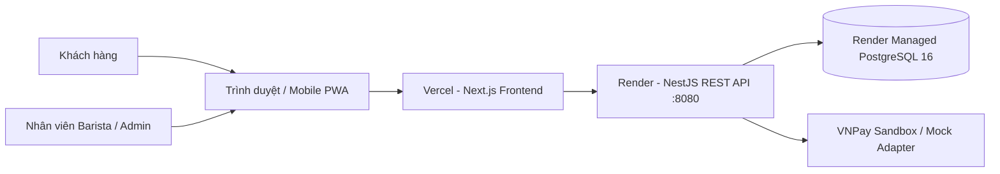
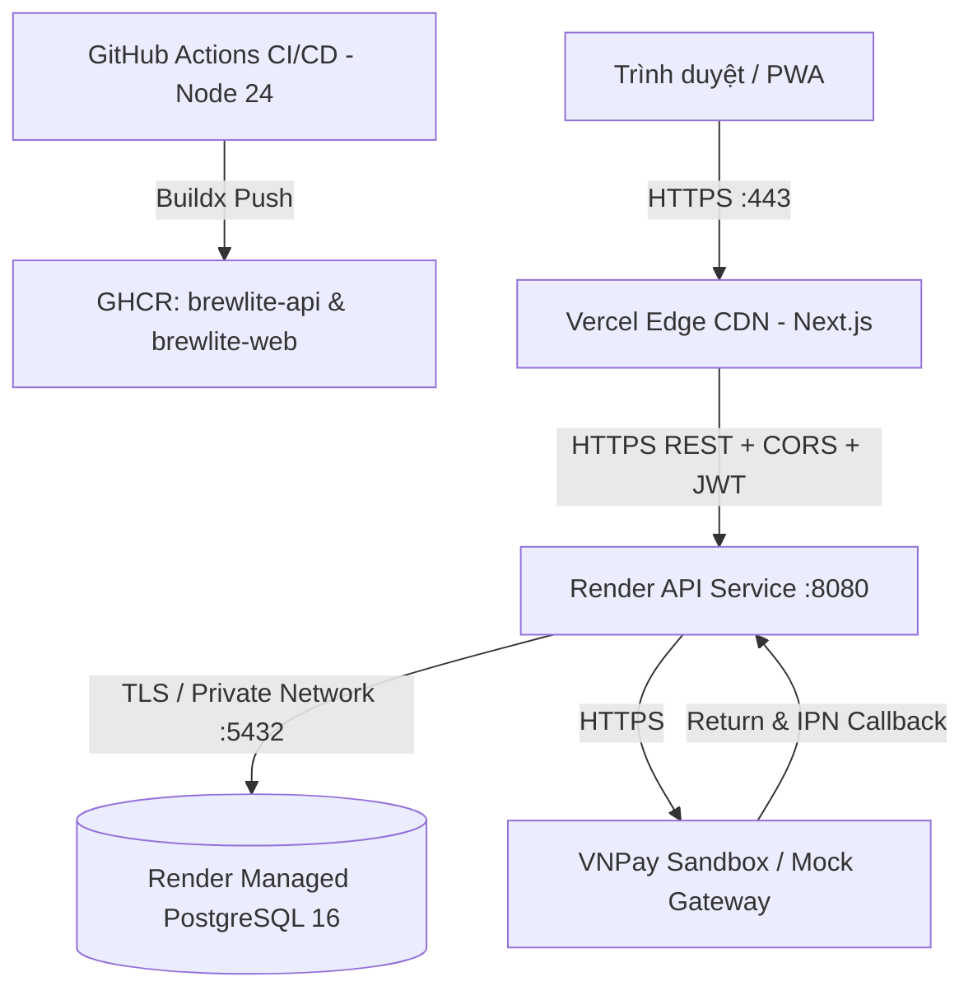

# BrewLite — Tổng quan kiến trúc hệ thống

> **Trạng thái:** Chính thức (Approved) — Đã đối chiếu đồng bộ với mã nguồn Monorepo và hạ tầng Production.

## 1. Mục đích và phạm vi

Tài liệu mô tả kiến trúc tổng quan chính thức của BrewLite — ứng dụng đặt cà phê không dùng tiền mặt, được phát triển trong khuôn khổ môn Công nghệ phần mềm (SGU).

**Phạm vi triển khai hiện hành (Core MVP + Phase 2):**
- **Khách hàng (`CUSTOMER`):** Duyệt thực đơn theo danh mục, tùy chỉnh size/topping, quản lý giỏ hàng (Zustand), đăng ký/đăng nhập JWT, áp dụng voucher & đổi điểm thưởng Loyalty (`PromotionsModule`), đặt hàng idempotent, thanh toán không tiền mặt (`VNPAY` Sandbox hoặc `MOCK`), xem chi tiết/lịch sử đơn và gửi yêu cầu hủy/hoàn tiền.
- **Nhân viên pha chế & Quản trị (`BARISTA` / `ADMIN`):** Cổng vận hành **Staff Portal (`/staff`)** quản lý toàn bộ đơn hàng (`GET /orders/staff/all`), cập nhật trạng thái pha chế theo State Machine (`PATCH /orders/:id/status`), quản lý kho nguyên liệu, công thức size S/M/L, nhật ký kiểm toán kho (`InventoryModule`) và phê duyệt yêu cầu hoàn tiền (`POST /orders/:id/approve-refund`).

## 2. Bối cảnh công nghệ

- **Frontend:** Next.js 16 (App Router), React 19, TypeScript, TailwindCSS v4, Zustand (Mobile-first & PWA `manifest.ts`).
- **Backend:** NestJS, TypeScript, REST API (Kiến trúc Modular Monolith), Swagger (`/swagger`).
- **Cơ sở dữ liệu:** PostgreSQL 16 (kết hợp **Prisma ORM** và cơ chế migration tự động — xem [ADR-002](adr/002-orm-selection.md)).
- **Repository:** Monorepo quản lý tập trung `apps/api/`, `apps/web/`, `docs/`, `tests/` (xem [ADR-001](adr/001-monorepo.md)).
- **Đóng gói & Triển khai:** Docker container (Node 24 Alpine), GitHub Actions CI/CD, GitHub Container Registry (`ghcr.io`), Vercel (Web), Render (API `:8080` & Managed PostgreSQL).

## 3. Bối cảnh hệ thống

Trình duyệt hiển thị giao diện Next.js App Router và gửi yêu cầu REST API đến Backend NestJS. Backend xác thực JWT, phân quyền RBAC (`RolesGuard`), kiểm tra DTO (`ValidationPipe`), áp dụng quy tắc nghiệp vụ (State Machine, Optimistic Locking, Idempotency) và truy cập PostgreSQL qua `PrismaService`.

**Payment Provider (`VNPAY` Sandbox / `MOCK`):** Hỗ trợ cấu hình qua `PAYMENT_PROVIDER` và công bố chế độ hiện hành tại `GET /payments/config`. Khi bật `VNPAY`, backend ký URL thanh toán bằng HMAC-SHA512 và xử lý Return URL (`/payments/vnpay/return`), IPN webhook (`/payments/vnpay/ipn`) và đối soát (`/payments/vnpay/reconcile`). Tuyệt đối không lưu thông tin thẻ nhạy cảm.

## 4. Góc nhìn triển khai thành phần

Kiến trúc triển khai phân tách rõ ràng ranh giới mạng:
- Mọi kết nối từ Internet công cộng đều bắt buộc qua **HTTPS** (`https://swe-project-assignment2.vercel.app` và `https://brewlite-api-2tuk.onrender.com`).
- Cơ sở dữ liệu PostgreSQL được Render quản lý với kết nối nội bộ / TLS, không mở cổng DB ra ngoài không kiểm soát.
- Secret (`DATABASE_URL`, `JWT_SECRET`, `VNPAY_TMN_CODE`, `VNPAY_HASH_SECRET`) chỉ tồn tại ở tầng Backend & Secret Store, không nằm trên Frontend.

## 5. Định hướng Frontend & Backend

### 5.1. Backend: Modular Monolith (`apps/api/src/`)
Ứng dụng NestJS API được cấu trúc theo mô hình **Modular Monolith** (root `AppModule`), phân tách rõ ràng từng module:

- **Auth Module (`auth/`):** Đăng ký, đăng nhập (`POST /auth/register`, `POST /auth/login`), hồ sơ (`GET /auth/me`, `PATCH /auth/profile`), băm mật khẩu (`bcrypt`), xác thực JWT (`JwtAuthGuard`) và phân quyền RBAC (`RolesGuard`).
- **Users (`users/`):** Định nghĩa thực thể người dùng (`entities/user.entity.ts`), phân quyền vai trò (`CUSTOMER`, `BARISTA`, `ADMIN`) và tích lũy điểm thưởng (`loyaltyPoints`), phối hợp trực tiếp với `AuthModule`, `OrdersModule` và `PromotionsModule`.
- **Products Module (`products/`):** Cung cấp danh mục và chi tiết đồ uống (`GET /products`, `GET /products/:id`), giá theo size `S`/`M`/`L`, topping hợp lệ và tồn kho (`stock`).
- **Orders Module (`orders/`):** Đặt đơn idempotent (`POST /orders`), danh sách đơn cá nhân (`GET /orders/me`), chi tiết đơn (`GET /orders/:id`), cổng đơn nhân viên (`GET /orders/staff/all`), chuyển trạng thái theo Order State Machine (`PATCH /orders/:id/status`), hủy đơn & duyệt hoàn tiền (`POST /orders/:id/cancel`, `POST /orders/:id/approve-refund`, `RefundRequest`), và tác vụ tự động hủy đơn `PENDING` quá hạn 10 phút (`OrderExpirationService` chạy định kỳ mỗi 15 giây).
- **Payments Module (`payments/`):** Đọc cấu hình cổng (`GET /payments/config`), thanh toán `MOCK` (`POST /payments`) và `VNPAY` Sandbox (`POST /payments/vnpay/create`, `POST /payments/vnpay/reconcile`, `GET /payments/vnpay/return`, `GET /payments/vnpay/ipn`), bảo vệ chống lặp `Idempotency-Key`, giới hạn tối đa 3 lần thử và hoàn tất đơn nguyên tử (`fulfillPaidOrder`).
- **Promotions Module (`promotions/`):** Kiểm tra & áp dụng voucher (`POST /promotions/apply`), danh sách voucher khả dụng (`GET /promotions/vouchers`), cộng điểm thưởng (`10.000đ = 1 điểm`) và đổi điểm lấy voucher (`POST /promotions/redeem-points` với `REWARD10K`, `REWARD20K`, `REWARD50K`).
- **Inventory Module (`inventory/`):** Dành cho `BARISTA`/`ADMIN`, quản lý nguyên liệu (`GET/POST/PATCH/DELETE /inventory/ingredients`, nhập kho `PATCH /inventory/ingredients/:id/stock`), nhật ký kho (`GET /inventory/ingredients/logs` — `IngredientAuditLog`), công thức theo size (`GET /inventory/recipes`, `POST /inventory/products`, `PUT /inventory/products/:id/recipes`) và đồng bộ tồn kho sản phẩm (`POST /inventory/recalculate-stock`).
- **Health Module (`health/`):** Cung cấp `GET /health` (`HealthController`) trả về trạng thái sống, `service`, `uptime`, `timestamp` và `environment`.
- **Common, Prisma & Observe (`common/`, `prisma/`, `@nestjs/observe`):** Cung cấp `PrismaService`, bộ lọc ngoại lệ toàn cục `AllExceptionsFilter`, lớp cơ sở `BaseEntity`, hàm tính giá chuẩn `pricing.util.ts`, hợp đồng kiểu `types/brewlite.ts` và `ObserveModule` (`@nestjs/observe`) đăng ký trong `AppModule`.

### 5.2. Frontend App Router (`apps/web/app/`)
Giao diện Next.js (Mobile-first, Zustand `cartStore`) gồm **9 route App Router thực tế**:
- `/` — Trang chủ & thực đơn đồ uống, lọc danh mục
- `/products/[id]` — Chi tiết sản phẩm, chọn Size `S`/`M`/`L` và Topping
- `/cart` — Giỏ hàng, chọn/áp dụng Voucher và khởi tạo thanh toán (`VNPAY` / `MOCK`)
- `/orders` — Lịch sử đơn hàng của khách hàng
- `/orders/[id]` — Chi tiết đơn hàng, theo dõi trạng thái, hủy đơn và đối soát thanh toán VNPay
- `/login` — Đăng nhập tài khoản JWT
- `/register` — Đăng ký tài khoản mới
- `/staff` — Cổng vận hành cho `BARISTA`/`ADMIN` (xử lý đơn hàng, duyệt hoàn tiền, kho nguyên liệu, công thức & Audit Log)
- `/UserProfile` — Hồ sơ cá nhân, số dư điểm thưởng Loyalty và đổi điểm lấy voucher

### Luồng xử lý yêu cầu chuẩn:
1. Client gửi yêu cầu REST API kèm Bearer JWT (và `Idempotency-Key` cho thao tác tạo đơn/thanh toán).
2. `JwtAuthGuard`, `RolesGuard` và `ValidationPipe` (`whitelist: true, transform: true, forbidNonWhitelisted: true`) thẩm định xác thực, quyền hạn và DTO.
3. Controller định tuyến sang Service nghiệp vụ.
4. Service áp dụng quy tắc kinh doanh, thực thi Database Transaction (`prisma.$transaction`) với Optimistic Locking / Row Lock qua `PrismaService`.
5. `AllExceptionsFilter` chuẩn hóa ngoại lệ HTTP; API trả về kết quả JSON thống nhất.

## 6. Tính toàn vẹn dữ liệu

- **Cơ sở dữ liệu:** PostgreSQL 16 (Render Managed PostgreSQL / Docker volume `pgdata`) gồm 12 model (`Category`, `Product`, `User`, `Order`, `OrderItem`, `Payment`, `Voucher`, `LoyaltyTransaction`, `Ingredient`, `RecipeItem`, `RefundRequest`, `IngredientAuditLog`).
- **ORM & Migration:** Sử dụng **Prisma ORM** (`apps/api/prisma/schema.prisma`) với migration có phiên bản ([ADR-002](adr/002-orm-selection.md)).
- **Database Transaction & Locking:** Toàn bộ quy trình tạo đơn (`orders.service.ts`) và hoàn tất thanh toán (`fulfillPaidOrder` với `FOR UPDATE`, trừ `Product.stock` theo `version`, trừ nguyên liệu theo `RecipeItem`, tăng `Voucher.usedCount` và cộng `loyaltyPoints`) chạy nguyên tử trong `$transaction`.

## 7. Các mối quan tâm xuyên suốt

### Bảo mật
- Kiểm tra dữ liệu đầu vào nghiêm ngặt bằng `class-validator` (`ValidationPipe`) tại Backend.
- Phân quyền theo vai trò (`RolesGuard` + `@Roles(Role.BARISTA, Role.ADMIN)`) và kiểm soát sở hữu đơn hàng theo `userId` trong Service.
- Băm mật khẩu bằng `bcrypt` với salt rounds = 10, không lưu hoặc log plain text.
- Xác thực chữ ký giao dịch VNPay bằng HMAC-SHA512 và kiểm tra origin hợp lệ (`NEXT_PUBLIC_VNPAY_ALLOWED_ORIGINS`).
- Không commit file `.env` lên Git; chỉ lưu mẫu `.env.example`.

### Lỗi, Giám sát & Health Check
- `AllExceptionsFilter` chuẩn hóa JSON lỗi (`statusCode`, `message`, `timestamp`, `path`), ẩn stack trace ở môi trường vận hành.
- Endpoint `GET /health` phục vụ Render/Docker healthcheck và post-deploy smoke test.

## 8. Chất lượng và Đánh đổi (Trade-offs)

| Khía cạnh | Quyết định kỹ thuật | Ưu điểm đạt được | Đánh đổi / Biện pháp kiểm soát |
|---|---|---|---|
| **Cấu trúc Repo** | Monorepo (ADR-001) | Dễ đồng bộ API - UI - Docs, CI/CD tập trung | Tách pipeline/thư mục rõ `apps/api` và `apps/web` |
| **Kiến trúc App** | Modular Monolith | Dễ debug, triển khai nhanh, giao dịch ACID thuận tiện | Ranh giới module rõ ràng để sẵn sàng tách service khi mở rộng |
| **ORM / Database** | Prisma ORM (ADR-002) | Type-safe toàn diện, schema & migration tường minh | Cần chạy `npx prisma generate` và `npx prisma migrate deploy` trong build/deploy |
| **Vòng đời đơn** | State Machine (ADR-003) | Tránh nhảy cóc trạng thái, kiểm soát bởi `assertOrderTransition` | Kết hợp scheduler tự hủy đơn `PENDING` quá 10 phút |
| **Thanh toán** | VNPay Sandbox / Mock + Idempotency | Hỗ trợ cả kiểm thử offline (`MOCK`) và cổng thật sandbox (`VNPAY`) | Lưu `checkoutKey` trên `Order`, `idempotencyKey` & `paymentUrl` trên `Payment` để chống trừ tiền trùng |

## 9. Danh mục Quyết định Kiến trúc (ADR)

- [ADR-001: Tổ chức Repository theo Monorepo](adr/001-monorepo.md) — **Accepted**
- [ADR-002: Lựa chọn lớp truy cập dữ liệu và ORM](adr/002-orm-selection.md) — **Accepted**
- [ADR-003: Quy định chuyển trạng thái đơn hàng](adr/003-state-machine.md) — **Accepted**

## 10. Trạng thái Đồng thuận của Nhóm

- [x] Đã thống nhất cấu trúc Monorepo (`apps/api/`, `apps/web/`, `docs/`, `tests/`).
- [x] Đã chốt lựa chọn PostgreSQL 16 và Prisma ORM cùng quy trình migration tự động.
- [x] Đã phê duyệt Order State Machine 7 trạng thái, luồng hoàn tiền `RefundRequest` và quản lý kho nguyên liệu.
- [x] Đã xác định rõ kiến trúc triển khai Production (Vercel, Render, Managed PostgreSQL, GHCR, VNPay Sandbox/Mock).
